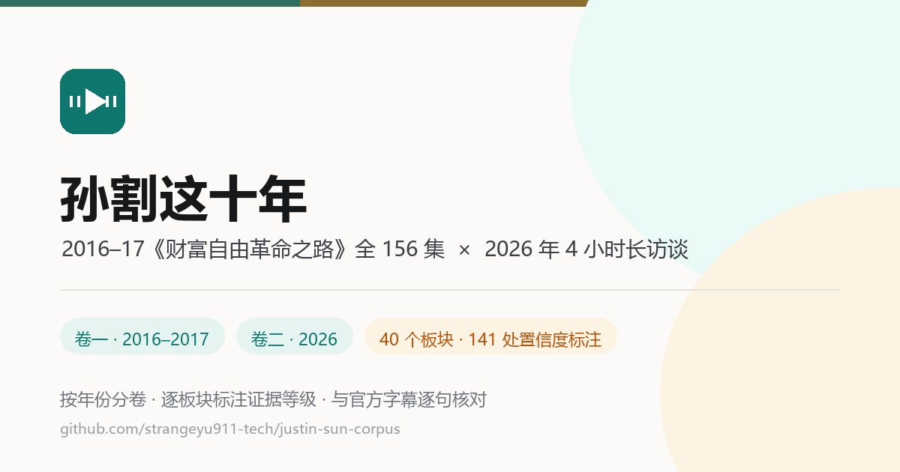

<div align="center">



# 孙割这十年

把同一个人跨度约十年的两套公开材料放在一起。<br>
讲 2016–2017 年那套 156 集付费音频里，他怎么重新定义财富自由、怎么讲战略与三大革命、怎么谈比特币和原始积累。讲 2026 年那场 4 小时 22 分长谈里，他怎么把话题换成 AI 托管、零资源起步、薄肌、逐水草而居和 Small Ego。<br>
按内容年份分卷，不打散重编。每个板块标注这块内容依据什么来源、出处是哪个讲号或哪一秒，50 条逐字引语全部带出处标签。

两卷相隔约十年，判断、口径与自我定位已经明显不同。首页的十年对照把 9 组说法并排放出来，判定它属于**延续 / 转向 / 加码**中的哪一类——每一行的左右两栏都各自有一手依据，精确到讲号或时间码。这里只做转述和来源定级，不下判断；唯一由编者下结论的是这页对照表，且明确标注为编者归纳。

素材可能过时，转写可能有错。发现写错了，欢迎[提 issue](https://github.com/strangeyu911-tech/justin-sun-corpus/issues)。

[](https://strangeyu911-tech.github.io/justin-sun-corpus/)
[](#两卷分别是什么)
[](#置信度标注长什么样)
[](#置信度标注长什么样)
[](#素材来源强度依次递减)
[](https://github.com/strangeyu911-tech/justin-sun-corpus/releases/tag/ebook-2026-10)
[](#许可)

### [打开在线阅读](https://strangeyu911-tech.github.io/justin-sun-corpus/) · [站点自检](https://strangeyu911-tech.github.io/justin-sun-corpus/audit.html)

<table>
<tr><td align="right" nowrap><b>读</b></td><td align="left">

[首页](https://strangeyu911-tech.github.io/justin-sun-corpus/)十年对照 9 组 · 卷一 [2016–2017](2016-2017-wealthfreedom.html) 26 个板块 · 卷二 [2026](2026-interview.html) 14 个板块

</td></tr>
<tr><td align="right" nowrap><b>体量</b></td><td align="left">

卷一 157 讲 / 156 集，≈ 29:55 音频 · 卷二 4:22:30，官方字幕 7,068 句

</td></tr>
<tr><td align="right" nowrap><b>离线</b></td><td align="left">

[电子书 PDF / EPUB](https://github.com/strangeyu911-tech/justin-sun-corpus/releases/tag/ebook-2026-10)：A4 PDF（133 页，带页码、目录与书签）+ EPUB3（6 章，可重排，适配阅读器与电子墨水屏）。封面与扉页印有整理者和完整网址

</td></tr>
<tr><td align="right" nowrap><b>标注</b></td><td align="left">

40 个板块来源徽章 · 141 处置信度标注（落在正文结论上 120 处）· 50 条逐字引语 100% 带出处

</td></tr>
<tr><td align="right" nowrap><b>自查</b></td><td align="left">

[audit.html](https://strangeyu911-tech.github.io/justin-sun-corpus/audit.html)：标签平衡、目录对齐、检索锚点、引语覆盖、行内样式、可访问名称，全部由脚本实测

</td></tr>
<tr><td align="right" nowrap><b>交流</b></td><td align="left">

QQ 群 **1130141971**（去 QQ 里搜群号）

</td></tr>
<tr><td align="right" nowrap><b>许可</b></td><td align="left">

[MIT](LICENSE)：整理、标注、编排与代码 · 原始素材著作权归各自权利人，不随仓库分发音频

</td></tr>
</table>

<sub>页面里涉及投资、加密货币、税务、房产、婚恋、健康与医疗的表述均为转述，不构成任何建议。孙宇晨本人是波场 TRON 创始人、加密资产的直接利益相关方。</sub>

</div>

---

## 两卷分别是什么

两卷内容不是同一种东西，所以没有混编：

| | 卷一 | 卷二 |
|---|---|---|
| 年份 | **2016 – 2017** | **2026** |
| 形态 | 喜马拉雅付费音频专栏，全 156 集 | 一次 4 小时 22 分长访谈，40 章 |
| 体量 | 157 讲 / 156 集，≈ 29:55 音频 | 4:22:30，官方字幕 7,068 句 |
| 页面 | [`2016-2017-wealthfreedom.html`](2016-2017-wealthfreedom.html) | [`2026-interview.html`](2026-interview.html) |
| 板块 | 26 个 | 14 个 |
| 素材来源 | B 站官方字幕 + 本地 ASR + 第三方转写仓 + 播客 AI 概要（**强度递减**） | B 站官方字幕（全片逐句） |

**注意一个容易搞混的点**：两卷的「内容年份」相差十年，但「在公开渠道重新上线」都发生在 2026 年。本站的年份分区一律指**内容年份**，`index.html` 有一节专门讲这件事。

## 方法论与写作纪律

口径沿用姊妹项目「[以日为镜](https://mirror.strangeyu.xyz/)」的五条写作纪律，逐条落地或明说偏离：

- **作者权威化 → 有意偏离。** 那一站是作者自己的判断，所以直接下结论；本站是**转述他人言论**，编辑不下判断，只做「转述 + 来源定级」。唯一由编者下判断的板块是首页的「十年对照」，且明确标注为编者归纳。
- **三级置信度 → 语义改造。** 那一站标的是「这个结论有多可信」；本站标的是**「这行字离原话有多远」**：

  | 标签 | 含义 | 怎么用 |
  |---|---|---|
  | `原话 · 已核字幕` | 有官方字幕或原视频逐字可核验，出处精确到讲号 / 时间码 | 可以当引用用 |
  | `转写 · 中可信` | 依据第三方 ASR 转写或二手压缩材料，同音字、断句、专有名词可能有误 | 引前须回原音 |
  | `概要 · 待核` | 别人已经压缩过一遍的概要，或标题 / 编号本身存疑、原片检索不到的流传说法 | 只能当线索 |

- **来源可追溯 → 用讲号与时间码替代参考文献。** 全站 **50 条逐字引语 100% 带出处标签**，分档规则是机械的：讲号 ≤ 080 判高档、081–145 判中档、146 及以后（含 `vol.xxx`）判低档；卷二一律高档。
- **数据纪律 → 三批材料证据强度递减，逐板块声明。** 两处「标题与内容不符」用本地 ASR 复核后写明（见下）。
- **风险写实 → 每卷各有一节「需要打折听的地方」**（卷一 12 条 / 卷二 6 条）。

## 置信度标注长什么样

分三个层级，共 **141 处**（落在正文结论上的为 **120 处**）：

1. **板块级（40 处）**——每个板块标题下一行来源徽章，说明这块整体依据什么、讲号或时间码区间是多少。
2. **卡片 / 索引级（约 40 处）**——速览卡片与逐讲索引分组各有来源行。
3. **引语级（50 条）**——每条逐字引语的出处行末尾挂标签。

**为什么段落中间不做逐句标注？** 「以日为镜」可以逐句标注，因为它的每一句都是作者的判断。本站的正文是连续转述，如果给每句话都盖章，会制造一种「逐句都核过了」的伪精度——而事实上同一段里的依据强度是一样的。所以定级放在段落**所属的来源区间**上。密度更低，但每一枚标签都是真的。

## 内容结构

**首页 `index.html`**：两卷入口 → 时间轴（内容年份 ≠ 上线年份）→ 十年对照（9 组）→ 置信度体系 → 素材来源 → 阅读前提

**卷一 `2016-2017-wealthfreedom.html`**（26 个板块）

1. 第一部分 · 课程主线（001–080）：这套课是什么 / 财富自由被重新定义 / 战略 / 三大革命 / 全球流动性过剩 / 原始积累三定律 / 明道 / 个人奋斗的道德合法性 / 投资实战 / 拥抱不确定性 / 家庭的边界
2. 第二部分 · 续篇与补遗（088–155）：互联网章 / 荐书《大败局》/ 比特币与区块链 / 医疗 / 家人边界 / 财富天问 / 财富流向 / From It to Bit / 终章 / 补遗 146–155
3. 索引与附录：全 156 讲逐讲索引（148 行）/ 金句精选（21 条）/ 概念词典（158 张卡）/ 需要打折听的地方（12 条）

**卷二 `2026-interview.html`**（14 个板块）

正文九段（按时间轴）：开场 / 用 AI 托管一天 / 零资源起步三件套 / 机会地图与「先探图再下注」/ 健康与薄肌 / 逐水草而居 / Crypto 与机器世界 / 认知操作系统 Small Ego / 财富自由之后
＋ 附录：概念词典 / 金句精选（12 条）/ 需要打折听的地方（6 条）/ 如果只做三件事

## 素材来源（强度依次递减）

| # | 来源 | 覆盖 | 强度 |
|---|---|---|---|
| 1 | B 站官方智能字幕（BV1bMtP6hE6S，80 P / 18:09:22） | 卷一 001–080（**77/80 讲有字幕轨**） | 高 |
| 2 | 本地 faster-whisper 转写 | 卷一 004 / 010 / 019 三个无字幕分 P | 中 |
| 3 | 第三方 ASR 转写仓 `diverHansun/justin-sun-podcast-markdown`（`asr_qwen`） | 卷一 088–145 | 中 |
| 4 | 小宇宙 AI 概要 + 时间轴 | 卷一 146–155 | 低 |
| 5 | B 站官方字幕（BV1fcHD6cEw3，7,068 句 / 04:22:28） | 卷二全片 | 高 |

**已查实的三个坑**（都写进了页面，没有藏起来）：

- **B 站第 010 分 P 的标题贴错了。** 本地 ASR 转写显示它的音频其实是《性与权力》，且**与第 019 分 P 是同一集重复音频**（开头逐字相同、相似度 0.85、时长差 5 秒）。真正的《因信仰自由而享受自由》是喜马原版第 15 讲（仅 7:08），B 站合集里并没有这一讲。
- **转写仓 081–087 ≡ B 站 074–080，不是缺口。** 标题 7/7 全中、时长差仅 +6～+39 秒。
- **网上流传的「37% 参照系决策模型」在卷二原片里一次都没出现**，是外部整理者套用的经典「最优停止」术语。

## 技术形态

- **纯静态站点**，无构建步骤、无框架、无依赖（除可选 CDN 二维码库）。GitHub Pages 直接托管。
- 共享资源只有两个：`assets/site.css`（26.8 KB / 527 行）、`assets/site.js`（17.9 KB / 426 行）。
- 三页 + 共享资源合计 **350 KB**；无位图、无 Web 字体（用系统字体栈）、无 JS 框架。
- 顶部栏（搜索 / 分享 12 渠道 / GitHub / 日夜模式）、抽屉式目录、滚动联动等交互的写法照搬自 [mirror-guide](https://github.com/strangeyu911-tech/mirror-guide)，并按本站内容做了适配。
- **禁用 JS 后仍可完整阅读**：只剩抽屉目录、搜索、分享与主题切换失效。

## 站点自检

所有数字都由脚本统计，不是人工数的。构建与自检流水线在 `_build/`：

```
extract.py  →  build.py  →  annotate.py  →  assemble.py  →  normalize.py  →  validate.py
抽取正文       挂来源徽章      卡片补标注       组装三页        行内样式归一      输出全部实测数据
```

自检六项（每次改动后重跑）：标签平衡（24 类差值 0）、目录双向对齐（无悬空 / 无孤立）、检索锚点（47 条 100% 命中）、引语覆盖（50/50）、行内样式（0）、可访问名称（0 缺失）。

结果与问题台账见 [`audit.html`](audit.html)（[在线](https://strangeyu911-tech.github.io/justin-sun-corpus/audit.html)）。

## 自行部署

```bash
git clone https://github.com/strangeyu911-tech/justin-sun-corpus.git
cd justin-sun-corpus
python -m http.server 8000   # 打开 http://localhost:8000/
```

GitHub Pages 无需构建：根目录即为站点根，`.nojekyll` 已就位。

## 许可

本站的整理、标注、编排与代码以 [MIT](LICENSE) 许可发布。

原始素材（音频、字幕、转写稿、播客概要）的著作权归各自权利人所有，本站不主张任何权利，也不随仓库分发音频。

## 免责声明

页面中所有涉及投资、加密货币、税务、房产、婚恋、健康与医疗的表述均**转述自公开材料，不构成任何建议**。

孙宇晨本人是波场 TRON 创始人、加密资产的直接利益相关方；卷一课程录制于 2016–2017 年，其中的行情、政策与个案结论**大量已经过时**，其中关于中医与双盲测试的论断是他的个人立场，**不是医学建议**。

卷一第 124–129 讲涉及对国内历史、财产权与教科书的极端论述，是全课政治敏感度最高的一段。本站**只作转述与来源标注，不作评价**，并在该板块与「需要打折听的地方」两处都做了提示。

---

整理与标注：[@strangeyu911-tech](https://github.com/strangeyu911-tech) · Strange Leo &lt;strangeyu911@gmail.com&gt;
